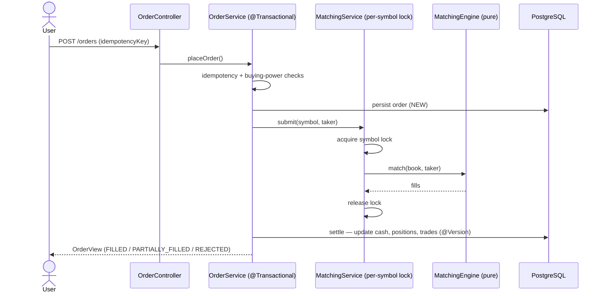

# TradingCo v2 — Paper Trading Platform with a Real Matching Engine

A production-grade mock trading platform built to demonstrate backend engineering depth:
a **price-time-priority matching engine**, concurrency-safe order execution, JWT auth with
refresh-token rotation, real-time market data over WebSockets, and a rigorous test suite
including a **concurrency test that proves the engine never over-fills**.

> This is a from-scratch rebuild of the original TradingCo, re-centred on backend
> architecture and correctness rather than UI.

[](../../actions)

---

## Why this project is different

Most paper-trading demos "simulate" fills with a random price. This one runs an actual
**limit order book**: incoming orders match against resting liquidity by price, then by time,
exactly like a real exchange. That single decision creates the hard, interview-worthy problems
this codebase solves — concurrency, transactions, idempotency and settlement.

| Capability | How it's demonstrated |
|---|---|
| Matching engine | Pure, framework-free `MatchingEngine` with price-time priority |
| Concurrency safety | Per-symbol locking + a test firing 200 parallel orders at fixed liquidity |
| Transactions | Order settlement updates cash + positions atomically |
| Optimistic locking | `@Version` on `Account` and `Position` guards concurrent writes |
| Idempotency | `idempotencyKey` makes order submission safe to retry |
| Auth | JWT access tokens + rotating, revocable refresh tokens |
| Real-time | STOMP-over-SockJS live quote streaming |
| Observability | Actuator, Prometheus metrics, structured JSON logs |
| Quality gates | JUnit 5 + Mockito + Testcontainers, GitHub Actions CI |

---

## Tech stack

| Layer | Technology |
|---|---|
| Backend | Java 21, Spring Boot 3.3 |
| Security | Spring Security, JWT (jjwt), BCrypt |
| Persistence | Spring Data JPA, PostgreSQL 16, Flyway migrations |
| Real-time | Spring WebSocket, STOMP over SockJS |
| Caching | Redis 7 (configured for shared state / horizontal scale) |
| Docs | springdoc-openapi (Swagger UI) |
| Testing | JUnit 5, Mockito, Testcontainers |
| Frontend | React 18, TypeScript, Vite, Zustand, @stomp/stompjs |
| Ops | Docker, Docker Compose, GitHub Actions |

---

## Architecture

Domain-driven, package-by-feature. Each module owns its controller → service → repository slice.

```
tradingco-backend/src/main/java/com/tradingco/
├── auth/         JWT, refresh tokens, security principal
├── user/         User + roles
├── instrument/   Tradable symbols
├── market/       Simulated prices + WebSocket publisher
├── matching/     ⭐ Order book + matching engine (framework-free core)
├── order/        Order lifecycle, settlement orchestration
├── portfolio/    Accounts (cash) + positions with optimistic locking
├── common/       Base entity, RFC 7807 errors, rate limiting
└── config/       Security, WebSocket, OpenAPI, properties
```

### Order flow (sequence)



### The concurrency strategy (key design decision)

Matching for a given symbol is **serialized by a per-symbol `ReentrantLock`** inside
`MatchingService`. This guarantees two orders for the same symbol are never matched at the
same time, so a resting order can never be double-filled. Settlement then writes to the
database under a transaction, with **optimistic locking (`@Version`)** on `Account` and
`Position` as a second layer of protection against concurrent balance updates.

- **Why optimistic over pessimistic?** Contention on a single account is low (a user rarely
  fires many simultaneous orders), so optimistic locking avoids holding DB row locks and
  scales better. Under the rare conflict, the transaction fails fast and can be retried.
- **Why a per-symbol in-memory lock?** The order book is an in-memory structure; a lightweight
  lock is far cheaper than round-tripping to the database for every match, and it keeps the
  matching hot path microsecond-fast.

### Idempotency

Every order may carry an `idempotencyKey`. A repeated key returns the **original** order
instead of creating a second one — so network retries never double-book or double-charge.

### Market maker liquidity

So a lone user always receives realistic fills, a synthetic market maker seeds resting bids
and asks around the current simulated price. Fills against the market maker settle only the
real (taker) account; fills between two real users settle both sides.

---

## Running locally

### Prerequisites
- Java 21+, Node 20+, Docker & Docker Compose

### Option A — everything in Docker (recommended)

```bash
docker-compose up --build -d
```

- Frontend: http://localhost:3000
- Backend API: http://localhost:8080
- Swagger UI: http://localhost:8080/swagger-ui.html

### Option B — local dev with hot reload

```bash
# 1. Start Postgres + Redis
docker-compose up postgres redis -d

# 2. Backend
cd tradingco-backend
mvn spring-boot:run          # http://localhost:8080

# 3. Frontend
cd tradingco-frontend
npm install
npm run dev                  # http://localhost:5173
```

Register an account in the UI — it's funded with simulated cash automatically — then place
market or limit orders and watch positions and P&L update live.

---

## Testing

```bash
cd tradingco-backend
mvn test                     # unit tests (no Docker needed)
mvn verify                   # + Testcontainers integration tests (needs Docker)
```

Highlights:
- `MatchingEngineTest` — price-time priority, partial fills, market sweeps
- `MatchingConcurrencyTest` — **200 parallel buyers vs fixed liquidity; asserts zero over-fill**
- `TradingFlowIntegrationTest` — full register → order → portfolio flow on real PostgreSQL
  (auto-skips when Docker is unavailable)

---

## API overview

| Method | Endpoint | Auth | Description |
|---|---|---|---|
| POST | `/api/v1/auth/register` | – | Create a funded account |
| POST | `/api/v1/auth/login` | – | Get access + refresh tokens |
| POST | `/api/v1/auth/refresh` | – | Rotate tokens |
| POST | `/api/v1/auth/logout` | – | Revoke a refresh token |
| GET | `/api/v1/instruments` | – | List tradable symbols |
| GET | `/api/v1/market/quotes` | – | Current quotes snapshot |
| GET | `/api/v1/orderbook/{symbol}` | – | Top-of-book depth |
| POST | `/api/v1/orders` | ✅ | Place a market/limit order |
| GET | `/api/v1/orders` | ✅ | List your orders |
| GET | `/api/v1/portfolio` | ✅ | Cash, holdings and live P&L |

WebSocket: connect to `/ws` (SockJS) and subscribe to `/topic/quotes`.

---

## AWS deployment plan

The app is written to be **12-factor and stateless** (stateless JWT auth, Redis for shared
state) so it scales horizontally behind a load balancer.

| Concern | AWS service |
|---|---|
| Application | ECS Fargate (containerized Spring Boot, 2+ tasks) |
| Database | RDS PostgreSQL |
| Cache / shared state | ElastiCache for Redis |
| Ingress | Application Load Balancer (sticky sessions not required) |
| Secrets | Secrets Manager (`TRADINGCO_SECURITY_JWT_SECRET`, DB creds) |
| Logs & metrics | CloudWatch Logs (JSON logs) + Prometheus scrape of `/actuator/prometheus` |

Required environment variables in production:

```
DB_URL, DB_USERNAME, DB_PASSWORD
REDIS_HOST, REDIS_PORT
TRADINGCO_SECURITY_JWT_SECRET   # base64-encoded 256-bit key
TRADINGCO_CORS_ALLOWED_ORIGINS
SPRING_PROFILES_ACTIVE=prod
```

---

## Known simplifications (honest scope)

- The matching happens in memory and settlement in the database within the same request;
  a durable event log / write-ahead approach would make the two fully atomic across a crash.
  For a paper-trading context this trade-off is acceptable and documented deliberately.
- The market data feed is a random-walk simulation, not a real exchange feed.
- Payment/funding is simulated (accounts are seeded with virtual cash).

## License

MIT
